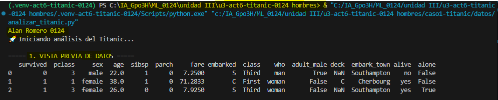
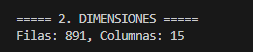
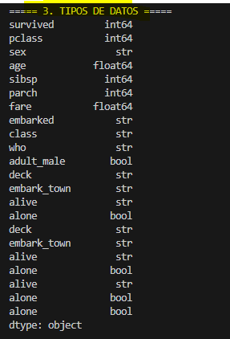
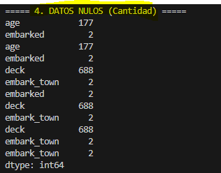
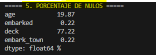
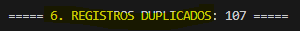
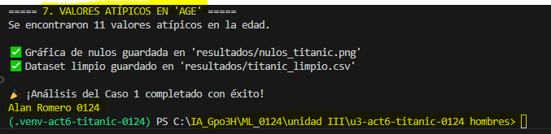

# 🕵️‍♂️ Práctica: Identificación de Problemas en los Datos

> **⏱️ Duración:** 2 horas  
> **🎯 Nivel:** Cero a principiante  
> **🤖 Área:** Machine Learning (Data Cleaning)  
> **💻 Herramientas:** Python, VS Code, Pandas, NumPy, Seaborn  

---

## 🎯 Propósito de la Práctica
Que los estudiantes aprendan a revisar conjuntos de datos (*datasets*) e identifiquen los problemas más comunes que pueden arruinar el entrenamiento de un modelo de Machine Learning. 

Trabajaremos con dos escenarios reales:
1. **Caso 1: Pasajeros del Titanic** 🚢 (Detección de problemas reales: nulos, duplicados, tipos y atípicos).
2. **Caso 2: Flores Iris** 🌸 (Detección de problemas simulados para aprender a depurar).

---

## 🧠 1. Conceptos Básicos

Antes de tocar el código, es fundamental entender los "4 jinetes del apocalipsis" de los datos:

| 🚨 Problema | 📝 Descripción | 💡 Ejemplo |
| :--- | :--- | :--- |
| **Datos nulos** | Información que no está registrada o es desconocida. | El campo "Edad" está vacío. |
| **Duplicados** | Registros idénticos repetidos, lo que sesga el modelo. | Dos filas con el mismo ID y datos. |
| **Tipos incorrectos** | Datos almacenados con un formato inadecuado. | La edad guardada como texto `"25"` en lugar de número `25`. |
| **Valores atípicos** | Valores extremos que se alejan del comportamiento habitual. | Una edad registrada como `250` años. |

> 💬 **Pregunta para iniciar la clase:**  
> *¿Qué creen que sucedería si entrenamos una IA para predecir supervivencia usando datos con edades de 250 años o campos vacíos?*

## Iniciando análisis del Titanic

## 1. VISTA PREVIA DE DATOS

## 2. DIMENSIONES

## 3. TIPOS DE DATOS

## 4. DATOS NULOS (Cantidad)

## 5. PORCENTAJE DE NULOS

## 6. REGISTROS DUPLICADOS

## 7. VALORES ATÍPICOS EN 'AGE'
